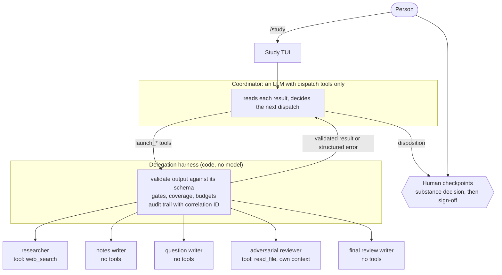
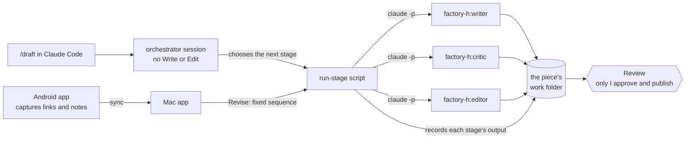

Why split one agent that can do everything into five narrower ones? Because the one that does everything is the hardest to evaluate. I want my agents to do more on their own, with each making decisions within a clearly defined scope of responsibility.


*The foreman delegates. The specialists do the work. A person approves the result or guides the next iteration.*

That means separating who does the work from who chooses what happens next. Automate what can be checked. Let the model decide when the criteria are clear. Hand it to a person when they aren't.

**The idea I'll keep coming back to: the foreman carries no tools.** The coordinator only decides who works next. Each crew member holds only the tools for their own job, and a person signs off at the end.


*The foreman hands out the work. The crew holds the tools.*

## Why not one big agent?

You could give one agent web search, file access, writing and review, and tell it to get on with it. Claude Code supports both doing that work in the main session and delegating to sub-agents. For the systems I’m describing here, I wanted to make the division of responsibilities explicit: the coordinator chooses who works next, and each specialist gets the tools its job requires. That’s a workflow choice you can implement in Claude Code too.

But when one agent researches, writes the notes and judges its own work, those responsibilities are harder to evaluate independently. When something is wrong, it takes more effort to trace where it went wrong. Splitting the work gives each job a defined input, an output and criteria you can test. Those measurements help you decide how much autonomy to give it.[^2]

[^2]: Separate agents don’t guarantee better results. The benefit is clearer responsibilities and independently testable outputs. Each specialist still makes decisions within its role; the coordinator decides who works next.

I have been building and architecting agents for the last few years, at my day job and in personal projects. Before that I was an Architect at Salesforce, where I [architected and built](https://engineering.salesforce.com/building-a-scalable-event-pipeline-with-heroku-and-salesforce-2549cb20ce06/) [data pipelines](https://engineering.salesforce.com/building-a-fault-tolerant-data-pipeline-for-chatbots-47d74bc31f5b/) for Desk.com, Einstein Bots and Agentforce. Agentic workflows are a natural progression of that work, and I love the learning that extends my background in distributed systems. What I enjoy is the detail: what works, what doesn't, and where the line sits between the system's decisions and mine.

This post comes from two perspectives. The reference system, the one I built for my Improving Stage 5 AI Certification, is built with Pydantic AI. And the agents that produced this blog post run from "FactoryHolton", a [Tauri](https://v2.tauri.app/) app I built that starts Claude Code agents from a plugin I wrote. From those perspectives I'll share what I have learned, and anchor it in Anthropic's Claude Academy courses.

## Three stages moved the control flow from my code to a model

Improving, where I work these days, has [internal stages](https://lnkd.in/p/e3N9UzC9) for evaluating a person's capability in building and architecting AI systems. Three matter for this post, and the last two are two answers to the question: *who decides what runs next?*

**Stage 3 is prompt evaluations.** You measure a prompt with evals. That matters because LLM outputs are probabilistic, and evals are how you make them more confined and predictable, for an acceptable percentage of the time, with the models being used.

**Stage 4 is a sequential workflow on the rails.** Stages run in a fixed order, with something like Temporal between them and data passed from one stage to the next. You can still have human-in-the-loop punch-outs, but the path is basically sequential. I built something like this for a startup in the past.

**Stage 5 is a coordinator (orchestrator) over sub-agents.** The coordinator does not have the tools the sub-agents have. Each sub-agent has a role, a confined set of tools, a goal and a data interchange format. The coordinator reads what comes back and "decides" where to go next. There is no preconfigured path, only a means to an end that the coordinator judges.

The shift from 4 to 5 is who owns the control flow. In Stage 4 my code does. In Stage 5 a model does, inside limits my code enforces. Stage 5 isn't simply the better one. It earns its place when the next step depends on what came back, and the rails earn theirs when it doesn't.[^3]

[^3]: A small celebration 🎉: I was the 4th person at Improving, out of 2000+, to earn the Stage 5 certification, and the first in the Improving Atlanta enterprise. I'm grateful to work where we positively challenge each other, and where the culture makes room to practice and learn.

## A sub-agent is a crew member with one job and one toolbox

Four things define a sub-agent in my design. It has a **role**, which is one job: researching, drafting, or "adversarial review". It has a **scoped set of tools**, only what that job needs.[^1] It has a **goal**, which says what done looks like. And it has a **data interchange format**, a typed output, so whoever runs it next receives something checkable instead of free text.

[^1]: "Only what that job needs" can mean nothing. In my build, the notes writer, question writer and final review writer have no tools, not even one to save their work. They return a typed result, and plain code checks it and writes the file. A writer that can't touch the disk can't put an unchecked file there.

The crew is the same whether it is *on the sequential rails* or directed under a foreman. What changes is who reads the output. On the rails, code passes it to the next stage. Under a foreman, a coordinator defined by what it lacks reads it: it can launch sub-agents and nothing else. It can't search the web, read files or sign anything off.

## The study-pack system puts a foreman, a rulebook, a crew and a person in one loop

For my Improving Stage 5 submission I built a system that produces study material for the Claude Certified Architect – Foundations exam (CCAR-F): grounded notes and original practice questions for each exam objective. The framing is building a set of materials to learn a topic, and anchoring it in a source of truth; in this case the Claude Certified Architect – Foundations objectives are the source of truth. A person reviews and signs off on the material.

This one needs a foreman, because the next step really does depend on what comes back: a review that raises a critical challenge sends work back for revision, and a clean one lets it move on.



**The coordinator governs and does no work.** Its only tools are five `launch_*` functions. It reads each result and picks the next dispatch. When the reviewer raises a critical challenge, it revises the challenged artifact and has it reviewed again. A test checks that the coordinator's bound tools are exactly the `launch_*` set, and that a manifest declaring a work tool is refused.

**The harness is plain code, with no model in it.** It sits between the coordinator and every sub-agent. Each sub-agent returns a typed output (a Pydantic model), and the harness validates it before the coordinator sees anything. It also writes the files itself, refuses out-of-order or stale work, and records every step with tokens, cost and the session's correlation ID. The coordinator gets either a validated result or a structured error, and never unchecked prose.[^4]

[^4]: Building this with the Pydantic AI framework helped me understand the mechanics of delegation, validation and tool boundaries firsthand. Later in this post, I compare those choices with some of what Claude Code provides through its agent configuration, CLI and hooks.

**Each sub-agent holds only its own tools.** Each agent is built from a manifest in `agents/` with only the tools it declares.

| Sub-agent | Tools |
| --- | --- |
| Researcher | `web_search` |
| Notes writer | none |
| Question writer | none |
| Adversarial reviewer | `read_file`, in its own context |
| Final review writer | none |

*Table 1: Tools given to each sub-agent.* The writers have no tools at all, not even one to save their work. Each returns a typed result, and the harness, plain code with no model, validates it and writes the file. A sub-agent can't put anything on disk that hasn't passed its schema.

The reviewer runs in a fresh context each time, with no shared history. It reads the session's files and checks claims against their sources.

**People decide at the checkpoints.** The coordinator chooses who works next, but it can't approve anything. The substance decision and the sign-off are a person's commands, recorded with their identity. Every session elevates to a person by design. At that point the person eliminates the ambiguity and provides direction, much like an attentive supervisor would.


*At the punch-out, the foreman asks. A person removes the ambiguity and points the way, like an attentive supervisor.*

## Evaluations measure the output of agent skills and the final result

Evaluations measure each sub-agent's output against criteria in the goal, the coordinator's decisions against scripted results, the reviewer's catch rate on planted defects, and whether the whole system completes a session end to end (3 of 3 live Domain 1 sessions). They also measure LLM cost for a given model used.

These figures come from my own evals and sessions:

- All 3 live sessions reached the human checkpoint with every task statement complete and a reviewed final review, with no manual correction.
- One full session made 63 dispatches, with 13 coordinator-directed revisions, and cost $0.32.
- The coordinator eval scored 24/24 against scripted sub-agent results.[^5]
- The adversarial reviewer caught planted defects 178/180 times, with clean twins to check it doesn't raise false alarms.
- Prompt caching cut the coordinator eval's cost from $0.169 to $0.053 with the same 24/24.

[^5]: The sub-agents in this eval are scripted stand-ins that make no model calls, so the right response is known in advance and only the coordinator, a live model, is under test. It covers eight scenarios, run three times each: a clean run, minor challenges only, a critical challenge, a challenged final review, a major challenge that survives one revision, invalid output, an infrastructure error, and a human checkpoint. To pass, it has to revise only what was challenged and send it back for review, retry invalid output once, stop on infrastructure errors and at the checkpoint, and leave minor challenges alone.

## The comparison case: Claude subagents as the "crew" behind reviewing my blog posts

To compare my Pydantic-based agents to Claude subagents, I built some Claude subagents for adversarial reviews for my blog posts. The agents that helped produced this post are invoked from an app I built for my own use, which I call FactoryHolton. It has a Mac app and an Android app where I can assemble my raw notes and start to craft a draft of a post.


*My sub-agents keeping me on task with the goals after adversarial review. "ASK MARK" questions review for accuracy, clarity, and other factors*

The Tauri app reaches Claude through Claude Code itself, not the API. Every stage goes through a small Python script, `run-stage`, which starts [Claude Code headless](https://code.claude.com/docs/en/headless) (`claude -p`) once per stage, as a named agent from a plugin I wrote: `factory-h:writer`, `factory-h:critic`, `factory-h:editor`. Each run can only read and write inside that piece's work folder, and the script, not the agent, records what each stage produced. The Android app never calls Claude: it captures links and notes and syncs them to the Mac, which runs the "writer", "critic", "editor" agents.

The app copies my plugin into the writing workspace.[^6] A small Python script, `run-stage`, then launches each specialist as a separate headless Claude Code session using `claude -p --plugin-dir … --agent factory-h:<role>`. These are supported CLI options: the plugin loads for that run without a separate installation step. Either my app or an orchestrator session decides the sequence; Claude Code runs each specialist. The plugin itself looks like this:

[^6]: The Tauri app never hands the plugin to Claude Code directly. It puts the files where Claude Code can find them, and the script tells Claude Code where to look.

```text
factory-h/
├── .claude-plugin/plugin.json   name "factory-h", version 1.0.0
├── agents/                      the crew: one Markdown file each
│   ├── writer.md   critic.md   editor.md
│   ├── angles.md                proposes angles for a piece
│   └── categorizer.md           sorts captures into projects
└── skills/                      shared know-how the agents load
    ├── marks-voice/             my 12 voice rules
    ├── evidence-and-attribution/
    ├── hugo-format/             front matter, figures, Mermaid, tables
    ├── geometric-builder/       the figure style and its reference sheet
    ├── editorial-review/        the critic's criteria
    └── project-matching/        for the categorizer
```
*The `factory-h` plugin: the agents are the crew, and the skills are the know-how they share.*

Each file in `agents/` is a sub-agent definition, and its frontmatter is where the tools go into the crew member's hands. Here is the editor's, for example:

```yaml
name: editor
tools: Read, Write, Glob
skills: [marks-voice, evidence-and-attribution, hugo-format, geometric-builder]
version: editor-5
```

The editor can read, write and find files, and that is all: no shell and no web search. It loads four of the shared skills, so it edits in my voice, keeps claims tied to their sources, and writes valid Hugo. The critic loads `editorial-review` and `evidence-and-attribution` but not my voice rules, so the one judging the draft works from review criteria, not from the instructions the editor writes by.

Who decides which stage runs next depends on how I start it. When I run `/draft` in Claude Code, an orchestrator session decides: it runs the writer, reads the critic's verdict, and chooses whether the editor runs again, at most two rounds, stopping early if the critic raises a question only I can answer. That's the Stage 5 shape, a foreman with no tools deciding from what comes back. When I press a "Revise" button in my Tauri app, nothing decides: the app runs a fixed sequence (open a cycle, run the editor with my comments, offer the new draft for review), which is Stage 4 and what I want there, because my comments already say what should happen. Either way, every run ends at review, and only I approve and publish.



Running it has taught me four things about delegating to Claude agents.

**The foreman's empty hands are a setting, not a request.** The orchestrator's permissions deny Write and Edit, and the only command it may run is the stage script. That's the foreman with no tools, enforced by configuration rather than by asking nicely.

**Stamp every agent with a version.** Each stage records its agent's version and a hash of its skills. When a revision came back in the old style, the manifest showed at a glance that editor-2 had run instead of editor-4: the app I was running still carried the old skills.

**The editor does exactly what it's told, and no more.** It's instructed to keep what works, so comments on single passages got single-passage fixes. To restyle the whole piece, I had to say so in one general note.

**Check what comes back before it counts.** A stage only counts once its output exists and is hashed into the manifest, and a figure has to pass an allowlist (no scripts or links in the SVG), or the stage fails outright. That is FactoryHolton's rulebook on the handback, the one Claude Code leaves to you.

## Comparing my Pydantic AI agents with Claude Code sub-agents

How does the crew I built with Pydantic AI compare with Claude Code’s sub-agents? Start with where they work: each Claude Code sub-agent gets its own context window and reports back to the parent with a summary.

Anthropic's subagents start from a different focus than responsibility: context. Every tool call, file read and search result in a Claude Code chat lands in the main context window, which is finite, and once it fills up Claude starts losing track of earlier parts of the conversation.

A sub-agent gets its own context window. It starts with two things: a custom system prompt from its configuration file, which defines its role and behaviour, and a task description written by the parent agent. It then works on its own, reading files, running searches or editing code, and when it's done only a summary comes back to the main conversation. Claude Code keeps the rest in a separate transcript file.

Anthropic's [Introduction to subagents course](https://academy.claude.com/courses/introduction-to-subagents) uses an example: finding which service handles refunds in an unfamiliar codebase. Without a sub-agent, Claude might read 15 files and run several searches, all of it filling your context when you needed one fact. With the built-in Explore sub-agent, your main context records only the question and the summary.

Claude Code ships with built-in sub-agents (General purpose, for multi-step tasks that need exploration and action; Explore, for fast codebase search; and Plan, used in plan mode), and you can write custom ones with their own system prompts and tool access: a code reviewer, a test writer, a documentation generator.[^7] If you'd rather watch than read, Anthropic's official video [What are subagents?](https://www.youtube.com/embed/jKErNxuxPXg) introduces them.

[^7]: In Claude Code, configuration controls delegation. A deny rule such as `Agent(Explore)` blocks that sub-agent. For an agent running as the main thread, `tools: Agent(worker, researcher)` permits only those two sub-agent types. An explicit tool list without `Agent` prevents spawning sub-agents through that tool. In FactoryHolton, the editorial specialists run with only `Read`, `Write` and `Glob`, so they cannot spawn built-in or custom sub-agents.

## A Claude Code "crew" member is one Markdown file

A Claude Code sub-agent is a Markdown file with YAML frontmatter, and the body of the file is the sub-agent's system prompt. Where you put the file decides who gets that crew member:

| Scope | Where the definition lives |
| --- | --- |
| Managed (organization) | `.claude/agents/` in the managed settings directory |
| CLI flag | `--agents '<json>'` at launch, not saved to disk |
| Project | `.claude/agents/`, searched from the working directory up to the repo root; the nearest wins |
| User | `~/.claude/agents/` |
| Plugin | the plugin's `agents/` directory; names become `plugin-name:agent` |

That is close to my `agents/` manifests: one file per crew member, with its prompt and its tools. The difference shows up at the foreman, at the dispatch and at the handback.

Here is the same comparison, one dimension at a time.

| Dimension | My Stage 5 build | Claude Code sub-agents |
| --- | --- | --- |
| Role | a manifest per agent, with a skill as its prompt | a Markdown file with YAML frontmatter; the body is the system prompt |
| Tool scoping | built with only its declared tools | custom sub-agents are configured with their own tool access |
| Coordinator without work tools | enforced by a test; manifests that declare work tools are refused | possible by configuration (`tools` limited to `Agent(...)`, or `--tools Agent`); nothing tests it for you |
| Who delegates | the coordinator decides; the harness gates every dispatch | the parent decides, prompted by each sub-agent's description (much as a Skill's description routes a prompt to it), or a person asks for one by name; the parent writes the task prompt; nothing gates it by default |
| Context isolation | the reviewer runs fresh, no shared history | a separate context window, seeded with its system prompt and the parent's task description |
| What comes back | a Pydantic model, validated by the harness | a free-text summary; the full run goes to a separate transcript; nothing validates it by default |

The two designs share the first of the course's benefits, breaking work into focused pieces. Where they differ is what each one is protecting. Claude Code's sub-agents protect the main context: you get the answer "without all the noise of the journey it took to find it". My harness protects the decision: the coordinator sees only checked, typed output.

## Where Claude's sub-agents differ from my build

Can the main Claude Code agent be a foreman with no tools? Yes, by configuration. You run the main thread as an agent definition whose `tools` is only `Agent(...)`, with `claude --agent coordinator`, or you start with `--tools Agent`.

Two things work differently from my build.

**Claude's sub-agents themselves can delegate too.** By default a sub-agent gets the same `Agent` tool the main session uses to hand out work, so it can start sub-agents of its own, up to three levels deep. In foreman terms, a crew member can hire their own crew. That's useful when a task really does split further, but it means the foreman no longer sees every hand-off. If you want a flat crew, take the tool away: leave `Agent` out of each sub-agent's `tools` list (or add it to `disallowedTools`), or turn nesting off everywhere by setting `CLAUDE_CODE_MAX_SUBAGENT_SPAWN_DEPTH` to 1.

**Test the foreman's boundaries.** In my Stage 5 build, a test fails if the coordinator holds anything but its `launch_*` tools. Claude Code enforces tool and permission restrictions, but you still need to check that your configuration matches your intended design. Assert the allowed tools in a configuration test, then verify in a scratch run that delegation works and direct work is blocked.[^8]

[^8]: For FactoryHolton that would be two checks: a test that reads the orchestrator's `.claude/settings.json` and fails unless it may run only `./run-stage` and `Read`, with `Write` and `Edit` denied, and a scratch headless run that asks it to edit a draft directly and confirms nothing changed.

The dispatch works the same way. In Claude Code the parent decides when to delegate, prompted by each sub-agent's description (similar to how a description in a Skill's front matter routes a prompt to it), or a person asks for a sub-agent by name, and either way the parent writes the task prompt. Nothing stands between that decision and the sub-agent by default. If you want a gate like my harness's refusals of out-of-order or stale work, a `PreToolUse` [hook](https://code.claude.com/docs/en/hooks) on `Agent` is where it goes.

The handback is the same story. The course names the tradeoff plainly: your main conversation "doesn't see how the subagent reached its conclusions." What comes back is a summary as free text, and nothing validates it by default. I think that is exactly where the foreman needs a rulebook, and you have three places to put one: a schema check in a `SubagentStop` or `PostToolUse` hook, a file the sub-agent writes that you then validate, or an evaluation of the saved transcripts afterwards. My Stage 5 harness does the first of these for every typed output, and my reviewer checks claims against their sources. FactoryHolton, the app behind this post, leans on the second, as its section above shows.

## Running the crew on a subscription

A side benefit of how I structured FactoryHolton, and not an accidental one, is that it runs on my Claude subscription (Pro or Max). The Tauri app never calls the API: it drives Claude Code, signed in with my Claude account. Whichever way a stage starts, it goes through `run-stage`, which first checks that Claude Code is signed in with a subscription and removes any `ANTHROPIC_API_KEY` from the environment, so nothing falls back to API billing. It's Claude Code's own headless mode, plugins and agents, run on my machine as me.

Claude Code still estimates each run at API prices, which makes a useful yardstick. When I measured it, this post's history (the writer, the critic and six editor rounds) came to about $3 API-equivalent, and an Opus round cost about twice a Sonnet one.

If a run hits my plan's usage limit, it stops with an error and I run it again later.

## What to take from the foreman

If you build one of these, start with what the foreman can't do.

- Give every sub-agent's job an eval. If a sub-agent does several things, eval each one on its own: my reviewer had four lenses, and each had its own planted-defect cases. LLM outputs are probabilistic, so you can't assume a prompt works because it worked once. Name the criteria, run each case several times, and change the prompt until it passes often enough for the model you use.
- Give the coordinator no work tools, and test that it has none. In Claude Code, limit the main thread to `Agent(...)`, or deny Write and Edit in its permissions, and write that test yourself, because nothing runs it for you.
- Ask whether the foreman has anything to decide. If the next step depends on what comes back, use a coordinator. If the instructions already say what should happen, run a fixed sequence and keep the model out of the control flow.
- Put a no-model harness between the coordinator and every sub-agent, and have it validate typed output before anything reaches the coordinator.
- Check each hand-off before it starts, not only the results after. If the coordinator asks for notes before the research is done, refuse the request instead of reviewing bad notes later. In Claude Code, a `PreToolUse` hook on the `Agent` tool can block a delegation before it starts; nothing gates by default.
- Scope each sub-agent's tools to its job, and run the reviewer in its own context. In Claude Code, if you want a flat crew, leave `Agent` out of sub-agents' tools (or add it to `disallowedTools`), or set `CLAUDE_CODE_MAX_SUBAGENT_SPAWN_DEPTH` to 1.
- Stamp every agent with a version and a hash of its skills, so you can tell which crew member actually ran.
- Decide where a person signs off, and make it a command the coordinator can't issue. Put the stop in the same place on the rails and under the foreman.
- As you are building and exploring, test so you can see your loop catch bad outputs. Stage a failure on purpose (a planted bad key, an invalid output), so you've seen the loop catch it.
- If you use Claude's sub-agents, treat the free-text summary as the boundary to check: a hook, a file you validate, or an eval over the transcripts.

That is the opening idea in practice, whether the crew is built in Pydantic AI or runs in Claude Code. The one agent that does everything is hard to evaluate, so split the work, take the tools off the foreman, check what the crew hands back, and keep the decisions that can't be checked for a person.

What I plan to work on some more is how to evaluate the foreman as well as I can evaluate the crew. Every sub-agent here has evals; the decisions between them mostly have my judgement.

## What to talk about next?

Graphs. Using graph tools like pydantic-graph or LangGraph in agentic workflows, and where they can help. A foreman with no preconfigured path still works inside routes, and graphs are one way to say which routes are allowed, somewhere between the rails and a free hand. That's a post of its own.

Tauri v2. FactoryHolton is one Tauri v2 codebase that builds both my Mac app and my Android app, with nothing to host: the phone syncs captures to the Mac, and the Mac runs the agents. That makes it a quick place to iterate and to explore ideas like the ones in this post. Why I chose Tauri, and what building for both platforms has been like, is outside the scope of this post, and a candidate for another.

## Sources

- [Improving mention on LinkedIn](https://lnkd.in/p/e3N9UzC9): Improving's internal stages.
- [Introduction to subagents (Anthropic Academy course)](https://academy.claude.com/courses/introduction-to-subagents): why Claude Code sub-agents exist (context), what a sub-agent starts with and returns, the refunds example, the built-in sub-agents, custom sub-agents, and the tradeoff quote.
- [Building a scalable event pipeline with Heroku and Salesforce (Salesforce Engineering)](https://engineering.salesforce.com/building-a-scalable-event-pipeline-with-heroku-and-salesforce-2549cb20ce06/): Mark's data pipeline work at Salesforce.
- [Building a fault-tolerant data pipeline for chatbots (Salesforce Engineering)](https://engineering.salesforce.com/building-a-fault-tolerant-data-pipeline-for-chatbots-47d74bc31f5b/): Mark's data pipeline work at Salesforce.
- [What are subagents? (Anthropic, official video)](https://www.youtube.com/embed/jKErNxuxPXg): an introduction to sub-agents.
- [Hooks (Claude Code docs)](https://code.claude.com/docs/en/hooks): `PreToolUse` on `Agent` as a place to gate a dispatch, and `SubagentStop` and `PostToolUse` hooks as a place to validate what a sub-agent returns.
- [Headless mode (Claude Code docs)](https://code.claude.com/docs/en/headless): running Claude Code non-interactively with `claude -p`, which FactoryHolton uses for each stage.
