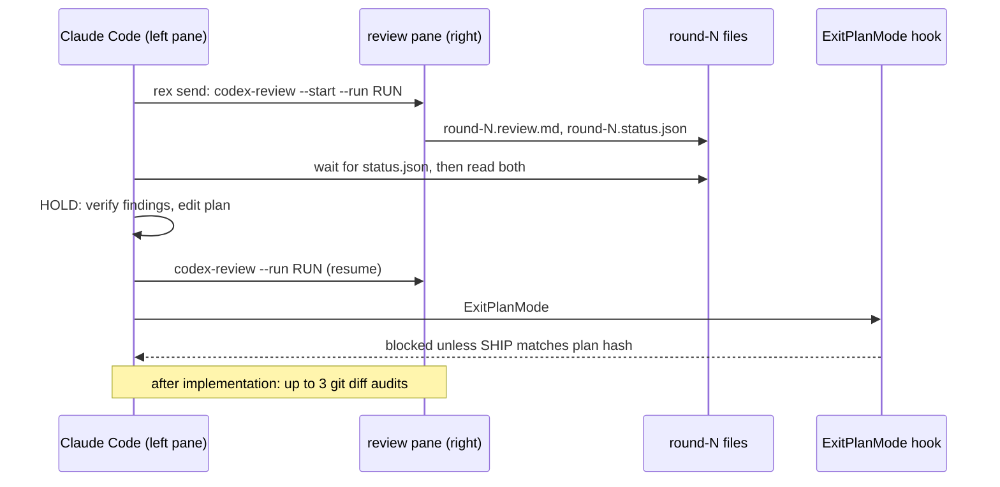

*Automated adversarial review across Rex's addressable panes: Claude drafts, Codex audits via verified files, and I get my coffee back.*

I have been exploring Rex, a new GPU-accelerated terminal and persistent multiplexer from Mitchell Hashimoto's company, Superlogical, built on libghostty. Superlogical puts it this way:

> "Rex is a drop-in replacement for whichever terminal you use today and you will feel an instant upgrade in user experience, quality, and capabilities such as persistent sessions, performant and responsive remote connections, program activity status, and more. Plus, it's simply beautiful."

I've used WezTerm for over two years and enjoyed customizing it. Since receiving my Rex invite, I am enjoying Rex's advantages for agentic coding and working in parallel, with the same level of customization and, frankly, the same pleasure in using it.

When exploring Rex, one lightbulb went on in my head that I could retire being a "human clipboard" between two AI models. Do you ever have Claude Code drafting a plan in one tab, and then copy it out by hand, pasted it into another model as a rough version of an adversarial reviewer, and carry back whatever edge cases it caught?

Rex is the terminal that let me hand the "human clipboard" job back to the agents, and the first time I did, I learned that an agent reading another agent's screen makes a bad clipboard too. The fix was to pass a file, not a screen, and to let a hook decide when a plan is allowed to reach me.

The first pass I did the clipboard job by hand between two panes. Then I handed it to Claude, which read Codex's screen through Rex via `rex capture`. Then I used Rex to let the agents to start passing files that a hook can check.

Before I share what I did, their [public testing beta](https://www.superlogical.com/updates/public-testing-beginning) is here, and this is the first post on Rex features I find useful. Part 1 is: an adversarial review between Claude Code's plan and Codex, running side by side in a repo I am working in.

## Luddite mode: me as the human clipboard

Before Rex, I'd often open a tab in a repository directory, start Claude Code, read through the generated plan, and jot down my own notes.

Often I'd copy that plan out of the repo by hand and paste it into another model to see what edge cases it caught. Most of the time, that cross-model review surfaced things I'd missed, so it became a useful step, even though doing it by hand felt clunky and mechanical.

And with several tabs going, there was no clean signal telling me which agent was blocked on a permission prompt or finished.

I wanted to automate that adversarial review: a second agent with its own clean context window, running directly alongside the first, without me in between.

## Why zsh and WezTerm can't take the copy-paste off you

You might ask why this needs a new terminal at all. Couldn't a shell script, or WezTerm's own splits, do the same job?

I don't think so, because I discovered a shell like [zsh](https://www.zsh.org/) and a traditional GPU terminal emulator like WezTerm work at completely different layers. `zsh` is a single-stream command interpreter inside one `pty` buffer.[^2] It has no native idea of split layouts, sibling panes or cross-pane communication, so a process running inside zsh can't spawn a visible neighbour pane, type into it, and inspect its state.

[^2]: *(Beyond the scope of this read, [you can read about pseudoterminals (`pty`) here](https://man7.org/linux/man-pages/man7/pty.7.html). It's basically a kernel-level bidirectional text pipe connecting a terminal window to a single shell process, which is why it has no awareness of sibling panes, window layouts, or cross-pane messaging the way Rex does.)*

WezTerm does have splits and a CLI (`wezterm cli`). But its primitives are built around a human managing tabs and panes: pane IDs are sequential integers, splitting a layout is tightly coupled to which window has focus, and automating it comes down to scraping the terminal grid. Scraping the grid is exactly the clipboard job again, just done by a script.

Rex closes that gap. Every session, window and block is a first-class object with its own address and type, behind a JSON-native control plane: `rex new --json`, `rex split`, `rex send`, `rex send-key`, `rex capture`. Three things in how it's built matter here, and the rest of the post leans on all three.

**Panes are addressable.** With `rex skill setup`, Claude Code and Codex both get the Rex skill and session-start hooks installed.[^1] Every terminal Rex opens receives `$REX_BLOCK`, the immutable UUID of that pane's own block (e.g., `block:01a10d99-...`), alongside `$REX_SERVER`. From there, an agent can inspect panes via `rex ls --json` and send commands or keystrokes into a neighboring pane by its block ID using `rex send` and `rex send-key`, without stealing focus or guessing window indices. The plan reaches the reviewer, and the critique comes back, without anyone copying and pasting.

[^1]: Take a look at ["What Agents Can Do"](https://www.superlogical.com/rex/docs/automate/agent-skill#what-agents-can-do) on the Superlogical site; it gets your wheels turning around some fun automations.

**Status is native.** Rex implements the [Program Status Protocol (OSC 7501)](https://www.superlogical.com/rex/docs/build/program-status), an [open terminal escape sequence authored by Mitchell Hashimoto](https://mitchellh.com/writing/program-status-osc7501) that lets CLI tools report `idle`, `working`, `blocked`, `done`, or `error` directly over the pty. [Claude Code (v2.1.295 and later)](https://www.swareco.com/blog/osc-7501-program-status-protocol) emits it natively after probing the terminal at startup, and interactive Codex sessions report status via Rex's integration—so the tab bar and session switcher show each agent's live state without fragile title-bar scraping. (When `codex-review` switches to headless `codex exec --json` rounds, the right-hand pane streams formatted `jq` progress directly while Rex tracks the active shell command.)

**Sessions outlive the window.** Rex separates a persistent background server, written in Go, from its macOS client built on Zig's `libghostty` rendering engine ([Terminal Trove: Rex by Superlogical](https://terminaltrove.com/terminals/rex-terminal/), [Superlogical: public testing announcement](https://www.superlogical.com/updates/public-testing-beginning)). Because the server owns your shells and multiplexer state independently of the GUI window, closing the app or reconnecting later doesn't tear down a review that's mid-round.

## First try: Claude takes the clipboard, on implementing a feature

The first real run was a plan to implement "swipe-to-delete" on an existing list in my "FactoryHolton" apps on Android and macOS apps I have been building, together with moving captures to Backlog. The Android app isn't a separate project: it's part of the same Rust/Tauri codebase in `~/git/holton-daily-os`.

This was the first version of the loop, before `rex-pair` and `codex-review` existed. Claude did the clipboard job I used to do: through Rex, I first had it type into interactive Codex's screen on the right panel and read the answer back off it.

### Claude draws the plan

As we all often now do, Claude Code drafts the implementation plan in Plan Mode before any code is written. This is the step where I used to read the plan, jot some notes, and then copy it out by hand for a second opinion.

<video controls muted playsinline preload="metadata" poster="/images/exploring-rex-part-1-addressable-panes-video-poster.jpg" style="width:100%;height:auto;border-radius:8px;" aria-label="Split-pane Rex window: Claude Code in plan mode on the left sends a plan to Codex in the right-hand pane and reads back Codex's numbered adversarial findings.">
  <source src="/videos/exploring-rex-part-1-addressable-panes.mp4" type="video/mp4">
  Your browser does not support embedded video. <a href="/videos/exploring-rex-part-1-addressable-panes.mp4">Download the clip</a>.
</video>

*Claude Code, in plan mode on the left, starts Codex in the right-hand pane with `rex send` and reads its adversarial review back with `rex capture`. Nobody copies or pastes anything.*

### Codex (or another model with its own context) argues with it

The reviewer's separate context is the biggest key in the automation. Codex hasn't followed the reasoning that *produced* the plan, only what it reads in the repo and the plan it's handed.

In that session, I ran the loop entirely during Plan Mode: Claude dispatched each review pass into the adjacent Codex pane with `rex send` and `rex send-key`, typed straight into Codex's input once its full-screen interface was running, and pulled the critique back with `rex capture`. That went round multiple `HOLD` → revision → `SHIP` iterations before I approved implementation.

Swipe-to-delete sounds like a small UI change. Across devices that sync, it isn't trivial, and that's where Codex pushed hardest. Its sharpest blockers in the captured review passes were about sync conflict invariants, offline retention windows and state initialization races:

> **Codex's sharpest HOLD findings**
>
> **Deletion vs. a later Backlog move.** Physically deleting a capture (removing its rows and files) under last-writer-wins state rules creates a contradiction: if one device deletes a capture while an offline peer later moves it to Backlog, you're left with no recoverable capture content, or the devices lose convergence on the winning state.
>
> **A 30-day tombstone window vs. offline peers.** Relying on a time-bounded window, such as a 30-day export/tombstone horizon, risks resurrecting deleted captures, or leaving peers out of sync, if a device stays offline past the window and later replays queued or lost-ack changes.
>
> **Initial state stamps vs. pre-upload Backlog choices.** Ingesting or backfilling a capture with a local timestamp can overwrite an earlier, intentional Backlog decision if ordering and initialization aren't explicitly constrained.

None of those is a typo-level nitpick. Each is a way two devices could disagree about whether a capture still exists. These are exactly the edge cases I used to go looking for by pasting a plan into a second model.

The swipe-to-delete and Backlog sync plan took **four rounds** to reach `SHIP`, starting with 16 findings in round one (*"I would not implement this plan unchanged"*). Across rounds one through three, the sync architecture was essentially rebuilt: deletions became permanent and always won over concurrent moves, initial capture states dropped local timestamps so they couldn't overwrite earlier decisions, a monotonic change counter replaced a simple dirty flag, and the 5-second Undo window was upgraded from an in-memory timer to a durable database record so a mid-window restart wouldn't resurrect a deleted item. Three minor edge cases (such as the 8 MiB message ceiling and legacy phone compatibility) were explicitly documented as accepted risks rather than silently dropped, and Codex confirmed they were stated accurately before issuing `SHIP` on round four.

I didn't override anything at the approval menu—both that feature plan and the five-round review of `codex-review` itself were approved only after reaching `SHIP`. Ironically, because the SHA-256 hook wasn't installed yet during those runs, I still folded in a couple of tiny wording tweaks from Codex's final `SHIP` notes right before approving—the exact kind of post-verdict edit the new hash gate now catches and blocks until re-verified.


*A second set of eyes: Codex challenges Claude Code's plan before anyone approves implementation.*

### The badges told me when to look

While Claude and Codex went back and forth, I didn't need to watch. The session switcher on the left stayed clean, showing `factoryh-swipe-delete`. The `swipedelete` window tab carried a small Claude badge and, whenever either agent in the window was actively running, an animated three-dot working indicator on the right side of the tab. Nice touches.  Once both agents had finished and were waiting on me (`SHIP` in Codex, the 1, 2, 3 approval prompt in Claude), the dots cleared (you can see some of this in the ScreenStudio capture video above).

Codex didn't have its content hiding behind its own tab, because it was in a split pane inside the same window. It showed its status in that pane's title bar (`Audit sync parity plan | holton-daily-os`) and in its inline footer, which went from `Working (58s)` to `Worked for 30s`. The tab aggregated active work across the panes, so one glance told me whether anything in the window was still busy.

The transitions matched what was actually happening. When Codex stopped on its workspace folder-trust prompt, the indicator paused rather than claiming it was still working. In the session switcher, background sessions showed badges too, like the blue unread/activity dot I saw on two other sessions.

## Why the screen made a worse clipboard

The review was good. The handoff wasn't ideal. Driving interactive Codex's screen was the fragile part, in three ways:

**The screen window itself.** Codex's full-screen view keeps no scrollback, so `rex capture | tail` only showed findings 14–16 of 16. The full review had to be dug out of Codex's session log in `~/.codex/sessions/`.[^3]

[^3]: Claude Code was able to catch it and dig out the session log, but it highlighted a flaw in using `rex capture` this way (it was damn fun to try and find that, though!).

**The "is it done?" signals lied.** The input line stays visible while Codex works, so it doesn't mean Codex is waiting. And the prompt itself contained "SHIP or HOLD", which matched before Codex had answered.

In other words, reading the screen had made Claude the new clipboard, with arguably a worse memory than mine. It's the same grid-scraping that makes WezTerm automation brittle, and Rex having `rex capture` is nice, but not for this handoff use-case. The plan file should be the handoff.

There was a second gap, separate from the screen. A rule in `CLAUDE.md` is still technically a *request*, and shouldn't be relied on. Claude can forget it, or reach for the 1, 2, 3 approval menu early. If the review is supposed to come before the approval menu, something other than Claude's memory has to enforce it.


*First try: Split-pane Rex terminal window: on the left, Claude Code in plan mode displays `rex capture`, `rex send`, and `rex block` call commands used to launch Codex in the adjacent pane and notes that Codex is waiting on a folder-trust prompt. On the right, OpenAI Codex (GPT-6-Astra medium) is actively running an adversarial plan review after reading plan and repository files.*

## An Improved Automation Between the Panes

Version (v5) fixed both gaps. Nobody copies, pastes or scrapes anything: Codex writes each round to its own files, Claude reads only those, and a hook refuses to let a plan reach me until Codex's `SHIP` matches the exact plan text.

Two pieces of my own do the work. **rex-pair** is a lightweight shell function that stands up the two-pane workspace. **codex-review** is a single executable at `~/.local/bin/codex-review` that runs each review round and holds all the gate logic.

`rex-pair` is only the workspace launcher and wiring. It doesn't run the review loop itself, and it doesn't log you into either service: both CLIs rely on your existing cached `~/.claude` and `~/.codex` logins. Claude Code plans in the left pane. Codex reviews in the right one, but only when asked: each round runs `codex exec` in that pane, so I can watch the review stream, and then writes its result to structured status and review files.

The review has two halves. During Plan Mode, the **SHIP gate** holds: a hook won't let Claude ask you to approve a plan until Codex has returned `VERDICT: SHIP` against the SHA-256 hash of that exact plan text, or four `HOLD` rounds are exhausted. Once the plan is approved and implemented, a post-coding loop runs up to three `git diff` audits against the approved plan before Claude reports the task complete. Both act only in a session where rex-pair has set `CODEX_REVIEW=1`.



*The v5 review loop: Claude dispatches `codex-review` into the right pane via `rex send`, reads atomic round files instead of scraping the terminal, and cannot call `ExitPlanMode` until the SHA-256 hook verifies a matching `SHIP` verdict.*

The steps below set it up in the order you'd build it.

### Step 1: Install the Rex skills and `codex-review`

First, install the Rex skills and session-start hooks for Claude Code (`~/.claude/skills/rex` and `~/.claude/settings.json`) and Codex (`~/.agents/skills/rex` and `~/.codex/hooks.json`) with one command:

```bash
rex skill setup
```
(Tested on macOS with Rex `0.1.0-preview.25`, `Claude Code 2.1.332`, and `Codex CLI 0.172.0`.)

Next, install codex-review (which requires jq and either shasum or sha256sum):

```bash
codex-review --install
source ~/.zshrc
```

That single command wires up the whole gate idempotently: it adds the `rex-pair` shell function to `~/.zshrc`, registers the ExitPlanMode hook in `~/.claude/settings.json`, adds the standing review rule to `~/.claude/CLAUDE.md`, and writes Codex's review rubric to `~/.claude/codex-review.md`.

### Step 2: Launch the pair with `rex-pair`

`rex-pair` builds the window from the right-hand side first, e.g., `rex-pair ~/git/holton-daily-os`:

**The right pane is the review pane.** `rex-pair` creates a new Rex session named after the repository, with a window called `review` whose first pane is a plain interactive `zsh`. That shell starts with `CODEX_REVIEW_REPO=<repo>` in its environment, so `cd`-ing elsewhere later can't drift the target repo—and round 1 also pins that path inside the review's `run.json`. No idle Codex app sits open in it. Instead, each review round runs `codex exec` there on demand, and `codex-review` turns Codex's `--json` event stream into a readable live progress view with `jq` so you can watch it work.

**The left pane is Claude.** `rex-pair` then splits a pane to its left, labelled `claude`, and starts `claude` with four environment variables:

```bash
CODEX_REVIEW=1
CODEX_REVIEW_SESSION=S      # the Rex session ID (e.g., session:01a2...)
CODEX_REVIEW_PANE=R         # the review pane's block ID (e.g., block:01a2...)
CODEX_REVIEW_REPO=<repo>
```

Those variables are the per-session opt-in switch. A Claude session started without `CODEX_REVIEW=1` doesn't run the review at all, so ordinary `claude` sessions stay untouched. One started with it receives the immutable IDs `S` and `R` at creation time, so it can dispatch commands into the review pane without stealing focus, guessing window indices, or polluting its own `$REX_BLOCK`. Because each `rex-pair` session is its own Rex session with its own IDs, you can run review pairs across several repos at once and let the badges tell you which one needs you.

### Step 3: The driver, a standing rule in CLAUDE.md

Claude Code reads `~/.claude/CLAUDE.md` as standing instructions in every project. `codex-review --install` adds a short rule there that activates whenever `CODEX_REVIEW=1` is set and Claude is in Plan Mode:

```markdown
## Codex plan review
When CODEX_REVIEW is exactly 1 and I'm in plan mode, run this loop before calling ExitPlanMode.
Sending review commands to the pane `-s $CODEX_REVIEW_SESSION -b $CODEX_REVIEW_PANE` is allowed in
plan mode; this rule allows nothing else beyond read-only work.
1. Finish the plan, including the "Codex round N" table from earlier rounds. Capture the pane to
   check it's at a shell prompt; if not, or if it shows a trust prompt, stop and ask me.
   Make up a review ID once per plan (8–64 characters from a-z, 0-9 and -). Send `codex-review --start --run RUN -- '<plan>'`
   for round 1, or `codex-review --run RUN -- '<plan>'` for later rounds. Use `rex send` and then
   `rex send-key enter`, writing `'` in the path as `'\''`.
2. The files are at `~/.claude/plans/reviews/<sha256 of real plan path>/runs/RUN/round-N.*`. Wait in
   a background Bash loop until `round-N.status.json` exists and no longer says `running`. Give up
   after 25 minutes and tell me. Never poll the pane. Read the status and that round's review.md.
3. On HOLD, check each finding against the code yourself. Fold the valid ones into the plan, record
   rejected ones with a reason in the round table, then run the next round. On failed, timeout,
   abandoned or invalid, show me the stderr excerpt and ask me.
4. Don't edit the plan after SHIP. The gate checks the exact text Codex approved.
5. After SHIP, or after the 4th completed round (tell me what's unresolved), call ExitPlanMode
   with a summary of what each round changed and the reviewed HEAD next to the current one.
```

Step 3 of that rule matters more than it looks. Claude isn't told to accept every `HOLD` finding blindly; it verifies each one against the codebase and logs any rejected findings with a reason in a `## Codex round N` table right inside the plan file. When the next round freezes `round-N.plan.md`, Codex sees both the updated design and why specific objections were declined, rather than watching them disappear silently.

Under the hood, `codex-review` pipes the frozen plan path and the fixed rubric from `~/.claude/codex-review.md` into `codex exec` on `stdin` with `-s read-only` (and `codex exec resume <SESSION_ID> -c sandbox_mode="read-only"` on rounds 2–4), requiring severity, `file:line`, failure scenario, and fix for each finding, ending with a strict `VERDICT: SHIP` or `VERDICT: HOLD` line.

Compare that with the first version. Claude still types into the review pane, but what it types is a shell command, not a prompt into Codex's input box. `codex exec` runs, each round's artifacts land atomically in `~/.claude/plans/reviews/<plan-sha256>/runs/<RUN>/`, and Claude only reads them once `round-N.status.json` is published. An old round can't bleed into the new one, and the words in the prompt can't pass for a verdict.

### Step 4: The hard gate, a thin hook over one tested executable

The rule in `CLAUDE.md` drives the loop; a [Claude Code `PreToolUse` hook](https://code.claude.com/docs/en/hooks) on `ExitPlanMode` enforces it. Whenever Claude tries to leave Plan Mode, Claude Code runs the hook first—and if it exits with code `2`, the tool call is blocked and the reason is fed directly back into Claude's context.

The hook itself (`~/.claude/hooks/codex-ship-gate.sh`, registered in `~/.claude/settings.json` with a 10-second timeout) is a 10-line wrapper that delegates straight to `codex-review --check-hook`. Rather than splitting gate logic across fragile shell hooks, `codex-review` keeps all of it inside one tested executable: validation, state management, idempotent installation, and clean uninstallation.

`codex-review --check-hook` hashes the current plan file (`tool_input.planFilePath`) with SHA-256 and checks the latest `round-N.status.json`. It fails closed and blocks `ExitPlanMode` if:

- no review exists for the plan;
- the latest round is still `running`, or ended `failed`, `timeout`, `abandoned`, or `invalid`;
- the verdict was `HOLD`;
- Claude edited the plan after `SHIP`, so its SHA-256 hash no longer matches.

Each block reason lands in Claude's context, forcing Claude to keep iterating with Codex until one of two conditions is met: either Codex returns `VERDICT: SHIP` for the exact SHA-256 hash of the current plan text, or the four-round ceiling is reached.

That second exit is deliberate. If Claude and Codex never reach agreement, four completed (`ok`) `HOLD` rounds open the gate so the disagreement surfaces to you—with every unresolved item listed—instead of spinning forever.

The SHA-256 check is the part I'd copy even if you copy nothing else. A `SHIP` approves one exact snapshot of the plan text. If Claude quietly tweaks the plan after Codex signs off, the hash changes and the gate snaps shut again.

### Step 5: An escape hatch

Keeping the logic in one executable also gives a practical way out when needed. At any moment, this tells you why a plan is blocked:

```bash
codex-review --check -- '<plan>'
```

And if you want to bypass the gate for a specific plan—typed directly at Claude Code's prompt using the `!` shell prefix—this records an override scoped to that plan's SHA-256 hash without touching global settings:

```bash
! codex-review --skip -- '<plan>'
```

Because the skip is tied to the hash, it covers that exact plan text only. If Claude edits the plan afterward, the hash changes and the gate closes again.

### Step 6: Break it on purpose, against a fake Codex

Before running a live session, I put the implementation through an offline harness of 42 automated checks against a mock Codex binary. They cover race conditions, `kill -9` runner crashes, timeouts, concurrent starts, symlinked paths, and stale `SHIP` verdicts invalidated by later edits to the plan.

That harness caught a process-lifecycle bug: the jq progress stream and the timeout watcher left orphaned `tail`, `jq` and `sleep` processes behind after a round finished or crashed. Fixing the process-group teardown eliminated the leaks.

Then came a live end-to-end smoke test against real Codex completed a full review round in 21 seconds, returned `SHIP`, and unlocked `ExitPlanMode` cleanly.

## SHIP isn't the same as correct

Obviously a `SHIP` verdict means one reviewer ran out of objections to one exact version of the plan. It doesn't mean the change is right, and the 1, 2, 3 menu is still your decision. When the gate opens at the four-round ceiling instead, you get the unresolved items, and that's a decision too. What the gate changes is what you're reading: work that has already survived a second model, instead of a first draft you have to carry somewhere else to test.


*Once Codex returns its SHIP verdict (Worked for 30s) and Claude Code settles at the 1 / 2 / 3 execution approval prompt, the swipedelete tab clears its active working indicator*

## Automated adversarial review, wired through Rex

Getting real value out of cross-model review isn't just about asking a second AI for an opinion, but is about giving the reviewer a clean context window and making the handoff deterministic. Exploring Rex gave me a clean control plane to automate that loop natively in the terminal: addressable panes (`$REX_BLOCK`, `rex send`), persistent sessions across restarts, and native OSC 7501 status badges that tell you at a glance when a multi-round review actually needs your eyes.

Pairing Rex's terminal primitives with a single-file orchestrator (`codex-review`) turns adversarial review into a reliable engineering gate:

* **Explicit routing over screen-scraping:** Each `rex-pair` session injects exact session and block IDs into Claude's environment, and Codex writes every round to atomic status and review files rather than an ephemeral TUI buffer.
* **Cryptographic plan enforcement:** Binding `ExitPlanMode` to the SHA-256 hash of the approved plan ensures that a `VERDICT: SHIP` applies only to the exact text Codex inspected—no silent post-verdict drift.
* **End-to-end verification:** Auditing the `git diff` after implementation gives the code the same independent scrutiny as the design, while leaving the final judgment call—and the targeted manual checks that follow `SHIP`—squarely in your hands.


## Sources

- [Superlogical: public testing announcement](https://www.superlogical.com/updates/public-testing-beginning): cited for Rex's public testing beta.

- [Rex Documentation: Agents & `rex skill setup`](https://www.superlogical.com/rex/docs/automate/agent-skill): cited for installing Rex skills and lifecycle hooks for Claude Code and Codex.

- [Rex Documentation: Automate the CLI](https://www.superlogical.com/rex/docs/automate/cli): cited for `$REX_BLOCK`, explicit pane targets, and `--json` automation.

- [Rex Documentation: CLI Reference](https://www.superlogical.com/rex/docs/reference/cli): cited for `rex ls`, `rex split`, `rex send`, `rex send-key`, and `rex capture`.

- [Rex Documentation: Program Status Protocol (OSC 7501)](https://www.superlogical.com/rex/docs/build/program-status)

- [Mitchell Hashimoto: A Terminal Protocol for Program Status (OSC 7501)](https://mitchellh.com/writing/program-status-osc7501)

- [SWARECO: OSC 7501, Explained (Claude Code v2.1.295 support)](https://www.swareco.com/blog/osc-7501-program-status-protocol)

- [Terminal Trove: Rex by Superlogical](https://terminaltrove.com/terminals/rex-terminal/): cited for Rex's client/server split (Go server and CLI, Swift macOS app, Zig `libghostty` terminal engine) and persistent multiplexer sessions. 

- [Claude Code Hooks Documentation](https://code.claude.com/docs/en/hooks)
